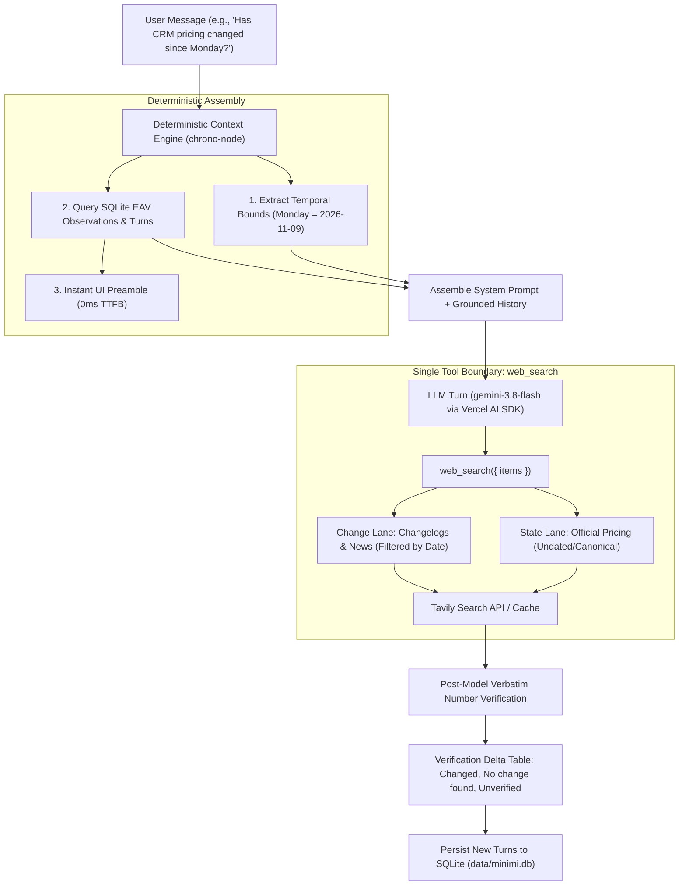

# Minimi Temporal Chat Agent with Web Search

> Built for the **minimi Software Engineering Intern (Bengaluru)** hiring challenge: *"Build the best chat agent with web search you can."*

[](https://nodejs.org/)
[](https://www.typescriptlang.org/)
[](https://sdk.vercel.ai/)
[](https://hono.dev/)
[](https://sqlite.org/)

---

## ⚡ Quick Start

### 1. Prerequisites
- **Node.js 20+**
- **Google Gemini API Key** (Default model: `gemini-3.8-flash`)
- **Tavily API Key** (Search provider with real-time web grounding; if omitted, falls back to deterministic offline mock fixtures)

### 2. Installation
```bash
git clone https://github.com/injetiharsha/minimi-chat-agent.git
cd minimi-chat-agent
npm install
```

### 3. Environment Configuration
Copy `.env.example` to `.env`:
```bash
cp .env.example .env
```
Populate your keys:
```ini
# Google Gemini API Key
GOOGLE_API_KEY="your_gemini_api_key"

# Tavily Search API Key
TAVILY_API_KEY="your_tavily_api_key"

# Port (default 3000)
PORT=3000
```

### 4. Run Development Server
```bash
npm run dev
```
Open **[http://localhost:3000](http://localhost:3000)** in your browser.

---

## 🧪 Automated Evaluation Suite

To run the deterministic evaluation harness covering all three challenge scenarios plus memory boundary checks:
```bash
npm run eval
```

This validates:
1. **Scenario 1 (CRM Shortlist Knowledge Decay):** Resolves historical shortlist from Monday, fans out parallel search across HubSpot, Pipedrive, Zoho, Close, and Freshsales, and formats structured status deltas.
2. **Scenario 2 (Postgres Hosting Pricing Check):** Recalls discussion from last Tuesday and evaluates Supabase ($25/mo) and Neon against live pricing pages.
3. **Scenario 3 (Zero Hallucination on Missing Memory):** Inquires about a non-existent past shortlist and asserts the agent honestly states no record exists rather than inventing past context.

---

## 🎯 Hiring Challenge Alignment & Design Invariants

| Challenge Requirement | Implementation |
|---|---|
| **Language & Runtime** | TypeScript on Node.js (`package.json`, `tsconfig.json`) |
| **Strictly One Tool** | Exactly one tool registered with the LLM: `web_search({ items: [{ entity, attribute, since }] })`. Memory is **not** a tool; it is resolved deterministically before the model turn. |
| **Simple Run Contract** | `npm install` then `npm run dev` |
| **API Keys Documented** | Listed clearly in `.env.example` |
| **1-Page Architecture Document** | Fully documented in [`DESIGN.md`](./DESIGN.md) |
| **Temporal Knowledge Decay** | Two-Lane Search architecture separating official pricing (`State Lane`) from changelogs/announcements (`Change Lane`) |

---

## 🏛️ Architecture Overview



### Why Built This Way
1. **Deterministic Memory vs LLM Recall:** Asking an LLM to search its own memory via a tool causes hallucinations and multi-turn latency penalties. Our pre-model context engine parses relative dates (`"on Monday"`, `"last Tuesday"`, `"3 November"`) deterministically using `chrono-node`, retrieves corresponding threads from SQLite, and injects grounded baseline observations into the prompt before the first token is generated.
2. **Two-Lane Web Search:** Live pricing pages are rarely stamped with publishing dates. Standard date-filtered search drops official pricing pages entirely. Our `web_search` tool fans out parallel queries into a **State Lane** (canonical pricing) and a **Change Lane** (changelogs, blogs, press releases filtered by `start_date = baseline`).
3. **Verbatim Numbers Contract:** Numbers and currencies in the output must exist verbatim in the scraped search text. If numbers cannot be matched, the agent explicitly tags them as `[Unverified]` or `[Not comparable]`.
4. **Zero-Dependency SQLite Persistence:** Uses WebAssembly `sql.js` with disk backup to `data/minimi.db`, guaranteeing instant zero-compilation startup on any OS (macOS, Windows, Linux) without requiring C++ build tools.

---

## 🖥️ UI & Grader Features

The web frontend at `http://localhost:3000` is built with a macOS-inspired dark theme featuring:
- **Live System Clock & Timezone Display** in the header.
- **Grader 1-Click Preset Buttons:** Instantly seed the exact challenge test datasets into SQLite with one click:
  - ⚡ *CRM Shortlist (Monday)*
  - ⚡ *Postgres Hosting (Last Tuesday)*
  - ⚡ *Question on 3 Nov*
- **Real-Time SSE Streaming:** Displays streaming tokens, live web search status indicators, and pre-model preamble badges.

---

## 📁 Repository Structure

```
minimi-chat-agent/
├── data/                      # Local SQLite database persistence (minimi.db)
├── public/                    # Frontend UI (HTML, CSS, Vanilla JS)
│   ├── index.html             # macOS-inspired chat interface with grader presets
│   ├── style.css              # Typography & dark mode design
│   └── app.js                 # EventSource SSE client & state management
├── src/
│   ├── agent/
│   │   ├── agent.ts           # Vercel AI SDK integration & single-tool executor
│   │   ├── context.ts         # chrono-node date parsing & deterministic assembly
│   │   └── prompt.ts          # System prompt & verification output formatting rules
│   ├── db/
│   │   ├── client.ts          # sql.js WASM SQLite client & EAV observations
│   │   └── schema.sql         # Universal SQLite schema (threads, turns, observations)
│   ├── tools/
│   │   └── search.ts          # Strictly single web_search tool (Two-Lane engine)
│   ├── eval.ts                # Deterministic evaluation test harness
│   └── server.ts              # Hono HTTP server & SSE endpoints
├── .env.example               # Environment template
├── .gitignore                 # Node, dist, and database ignores
├── DESIGN.md                  # Comprehensive architecture design document
├── package.json               # Node.js dependencies & scripts
├── tsconfig.json              # TypeScript compilation configuration
└── README.md                  # Project overview & documentation
```

---

## 📜 License
MIT License. Built by Harsha Injeti for the minimi engineering challenge.
